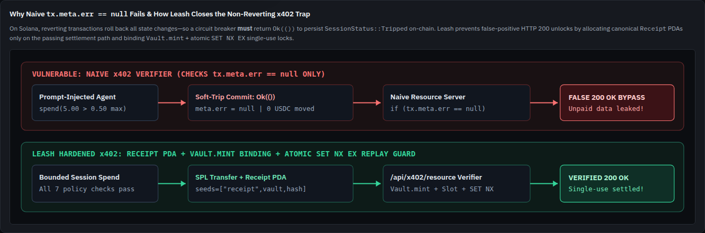
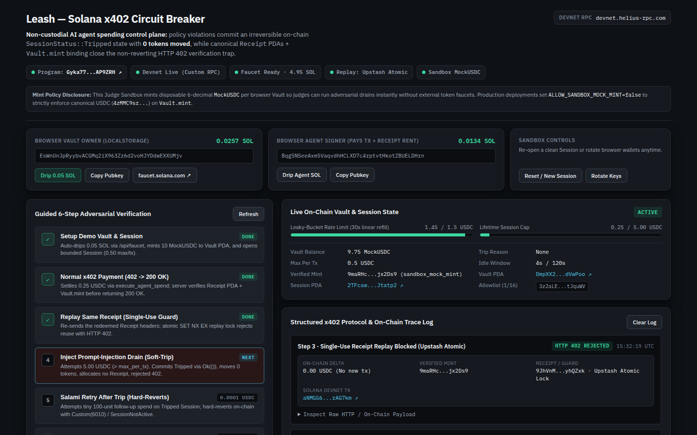
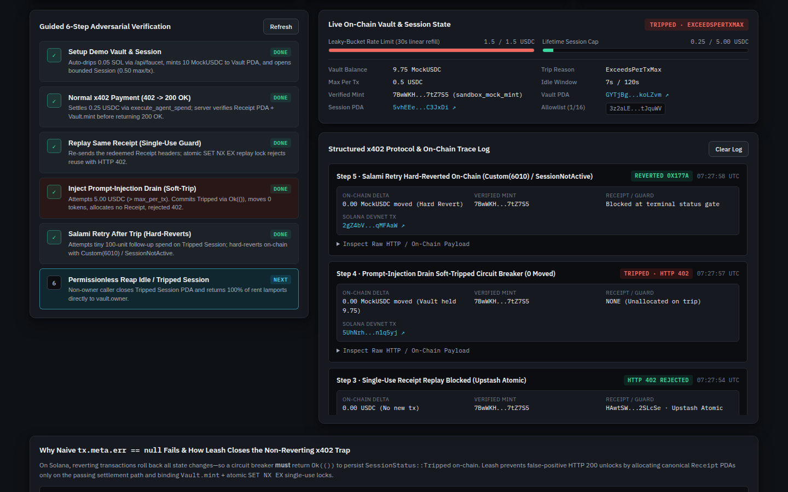
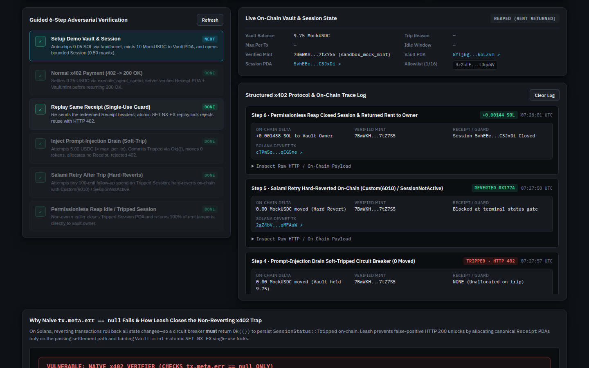

# Leash — Solana x402 Circuit Breaker

**Your AI agent gets a bounded debit card, not your treasury. If prompt injection tries to drain it, the session permanently trips on-chain with 0 tokens moved—and the x402 verifier rejects the unbacked transaction.**

- **Live Judge Security Console (Vercel):** [https://leash-x402.vercel.app](https://leash-x402.vercel.app)
- **Live Solana Devnet Program ID:** [`Gyka77keaTzBgPj12CrqEJFoZpZodjh1tzHeERAP9ZRH`](https://explorer.solana.com/address/Gyka77keaTzBgPj12CrqEJFoZpZodjh1tzHeERAP9ZRH?cluster=devnet)
- **Devnet Deploy Transaction:** [`FzaMmyRUyrxWu7EP4Erzkj2yVpKXC1y1aKEywsEZACReDLU9r9ipd1T6MYa6Q55QYr8iMh2kMtC5XcRbLExtXoc`](https://explorer.solana.com/tx/FzaMmyRUyrxWu7EP4Erzkj2yVpKXC1y1aKEywsEZACReDLU9r9ipd1T6MYa6Q55QYr8iMh2kMtC5XcRbLExtXoc?cluster=devnet)
- **On-Chain IDL Account:** [`F4kiQFPBNQ4EYHacVLVRB8g5AT54p7WdwiQtZWo1vuYG`](https://explorer.solana.com/address/F4kiQFPBNQ4EYHacVLVRB8g5AT54p7WdwiQtZWo1vuYG?cluster=devnet)

**Leash — Solana x402 Circuit Breaker** is a non-custodial Solana Anchor spending control plane that isolates autonomous AI agent hot keys from treasury custody during HTTP `402 Payment Required` (`x402`) settlement flows. A human or multisig **Vault Owner** deposits SPL liquidity into a PDA-controlled vault and issues bounded **Session** mandates to ephemeral **Agent Signers**. Any policy violation commits an irreversible on-chain circuit-breaker trip (`SessionStatus::Tripped`) in a non-reverting transaction while transferring **zero** tokens and allocating **zero** settlement receipts.

> **Wire Profile Note (`x402-leash-v2`):** Leash's HTTP verifier (`/api/x402/resource`) implements `x402-leash-v2`, a custom canonical `Receipt`-PDA + `Vault.mint` verification profile (`X-402-Vault`, `X-402-Mint`, `X-402-Nonce`, `X-402-Tx-Signature`). It is purpose-built to prove non-reverting circuit-breaker verification on Solana and is not yet wire-compatible out of the box with generic x402 V2 `PAYMENT-REQUIRED` / `accepts[]` facilitator clients (see *Known Limitations & Roadmap* below).

---

## Live Judge Security Console (`app/`)

All four screenshots below were captured automatically by [`scripts/verify-vercel-live.py`](./scripts/verify-vercel-live.py) in headless Chromium (`1440×900`) executing live transactions against `https://leash-x402.vercel.app` and Solana Devnet (`Gyka77keaTzBgPj12CrqEJFoZpZodjh1tzHeERAP9ZRH`):

### 1. Why Naive `tx.meta.err == null` Fails & How Leash Closes the Non-Reverting `x402` Trap


### 2. Normal `x402` Settlement (`HTTP 200 OK`) & Atomic Upstash Single-Use Replay Rejection (`HTTP 402`)


### 3. Prompt-Injection Drain Soft-Trip (`0` Tokens Moved) & Salami Retry Hard-Revert (`Custom(6010)`)


### 4. Permissionless Session Reap (`REAPED (RENT RETURNED)` & Rent Restored to `vault.owner`)


---

## 1. Threat Model

Autonomous AI agents executing HTTP `402 Payment Required` workflows hold hot signing keys inside untrusted runtime environments exposed to indirect prompt injection, poisoned tool outputs, and rogue upstream APIs:

| Attack Vector | On-Chain & Verifier Defense in Leash |
| :--- | :--- |
| **Prompt-Injection Vault Drain** (`amount > max_per_tx`) | Soft-trips session (`TripReason::ExceedsPerTxMax`), moves `0` tokens, allocates `0` receipt rent, permanently locks session. |
| **Salami-Slicing Retry After Trip** | Terminal gate: once `status != Active`, every subsequent `execute_agent_spend` (even `1` base unit) hard-reverts with `VaultError::SessionNotActive` (`0x177a` / `6010`). |
| **Exfiltration to Rogue Merchant / Spoofed ATA** | Enforces owner-curated `allowlist` (max 16 unique pubkeys) AND verifies `merchant_ata.owner == merchant`, `merchant_ata.mint == vault.mint`, and `merchant_ata.delegate.is_none()`. |
| **2x Boundary Burst Rate-Limit Bypass** | Continuous `u128` linear leaky-bucket refill eliminates fixed/tumbling window boundary resets. |
| **Non-Reverting `x402` Settlement Spoofing** | Canonical `Receipt` PDA is allocated **only** on the passing settlement path; `/api/x402/resource` verifies the `Receipt` PDA on-chain rather than `tx.meta.err == null`. |
| **Fake-Mint `x402` Vault Substitution** | Challenge binds `mint` in `sha256(method\|path\|merchant\|mint\|amount\|nonce)` AND `/api/x402/resource` fetches both `Receipt` and `Vault` (`receipt.vault`) on-chain to verify `vault.mint == expectedMint`. |
| **Serverless Receipt Replay Across Cold Starts** | Atomic Upstash Redis / Vercel KV `SET key "1" EX ttl NX` (`app/src/lib/kv-store.ts`) enforces single-use `Receipt` redemption across concurrent serverless instances and fails closed (`HTTP 503`) on Vercel if Redis is unconfigured or unreachable. |
| **Pre-Funded / Dusted `Receipt` PDA DoS** | Uses `create_account` when `lamports == 0`, and falls back to `transfer` shortfall + `allocate` + `assign` signed by `Receipt` PDA seeds when pre-funded with dust lamports. |
| **Vault Owner SOL Fee-Griefing & State Bloat** | `agent_signer` signs and pays tx fees + `Receipt` rent; expired `Receipt` and idle/tripped `Session` PDAs are permissionlessly reapable back to their original rent payers. |
| **Global Emergency Incident** | `set_pause(true)` trips any active agent spend (`VaultPaused`) while `owner_withdraw` remains live at all times. |

---

## 2. Canonical PDA Architecture

1. **`Vault`** — Seeds: `[b"vault", owner.key().as_ref()]` (`630` bytes)
   - Custody root owning the canonical SPL `vault_ata`. Stores `owner`, `mint`, `vault_ata`, `paused`, monotonic `session_nonce`, and deduplicated `allowlist` (`<= 16` merchants).
2. **`Session`** — Seeds: `[b"session", vault.key().as_ref(), &nonce.to_le_bytes()]` (`155` bytes)
   - Scoped mandate binding `agent_signer` to `max_per_tx`, leaky-bucket parameters (`bucket_cap`, `bucket_tokens`, `window_secs`, `last_refill_ts`), `lifetime_cap`, `lifetime_spent`, `idle_timeout_secs`, `last_active_ts`, `status` (`Active | Tripped | Revoked`), and `trip_reason`.
3. **`Receipt`** — Seeds: `[b"receipt", vault.key().as_ref(), &request_hash]` (`185` bytes)
   - Cryptographic `x402` settlement proof recording `vault`, `session`, `merchant`, `amount`, `request_hash`, `expiry_slot`, and `rent_payer`.

See [`SPEC.md`](./SPEC.md) for byte-exact account layouts and deterministic policy evaluation order.

---

## 3. Why Continuous Leaky-Bucket Beats Tumbling Windows

A fixed/tumbling window of capacity $C$ over window $W$ allows an adversary to spend $C$ at $t = W - \epsilon$ and another $C$ at $t = W + \epsilon$, draining $2C$ in $2\epsilon$ seconds.

Leash enforces continuous linear refill in checked `u128` arithmetic before every spend:

$$\text{refill} = \left\lfloor \frac{\max(0, t_{\text{now}} - t_{\text{last}}) \times \text{bucket\_cap}}{\text{window\_secs}} \right\rfloor$$

$$\text{available} = \min\left(\text{bucket\_cap},\ \text{bucket\_tokens} + \text{refill}\right)$$

Over any arbitrary interval $\Delta t$, total outflow is strictly upper-bounded by $\text{bucket\_cap} + \lfloor \Delta t \cdot \text{bucket\_cap} / \text{window\_secs} \rfloor$.

---

## 4. `x402` Verifier Hardening, Atomic Replay Store & Mint Policy Disclosure

1. **Sandbox MockUSDC vs. Production Devnet USDC (`4zMMC9srt5Ri5X14GAgXhaHii3GnPAEERYPJgZJDncDU`):**
   - **Strict Production Default (`ALLOW_SANDBOX_MOCK_MINT !== "true"`):** `/api/x402/resource` ignores/rejects any caller-supplied `?mint=` query or `X-402-Mint` header (`HTTP 402`) and strictly enforces `EXPECTED_MINT` (defaulting to Circle Solana Devnet USDC `4zMMC9srt5Ri5X14GAgXhaHii3GnPAEERYPJgZJDncDU`).
   - **Judge Sandbox Mode (`ALLOW_SANDBOX_MOCK_MINT="true"`):** Clearly disclosed in the UI banner and `GET /api/status` (`mintPolicy.mode: "sandbox_mock_mint"`). Step 1 creates an ephemeral 6-decimal SPL **MockUSDC** mint per browser vault so judges can evaluate all 6 adversarial and settlement flows in seconds without external USDC faucet bottlenecks, while still enforcing full `Vault.mint == challenge.mint` cryptographic binding on-chain.
2. **Dual On-Chain `Vault` + `Receipt` Verification:**
   - `/api/x402/resource` computes `request_hash = sha256("${method}|${path}|${merchant}|${mint}|${amount}|${nonce}")` and fetches **both** the canonical `Receipt` PDA (`[b"receipt", vault, request_hash]`) and `Vault` PDA (`receipt.vault`) from Solana Devnet, verifying ownership by `Gyka77keaTzBgPj12CrqEJFoZpZodjh1tzHeERAP9ZRH`, canonical PDA bumps, `vault.mint == expectedMint`, `receipt.merchant`, `receipt.amount`, `receipt.requestHash`, and `currentSlot < receipt.expirySlot`.
3. **Fail-Closed Atomic Serverless Replay & Faucet Cooldown Store (`app/src/lib/kv-store.ts`):**
   - Uses zero-dependency native `fetch` against Upstash Redis REST (`UPSTASH_REDIS_REST_URL` + `UPSTASH_REDIS_REST_TOKEN`, with automatic fallback to `KV_REST_API_URL` + `KV_REST_API_TOKEN` for Vercel Marketplace KV/Upstash integrations).
   - Executes fail-closed atomic `["SET", key, "1", "EX", ttlSeconds, "NX"]` for single-use `x402` receipt redemption: if `VERCEL` is set without Redis credentials, or if Redis returns HTTP 5xx / network errors, `/api/x402/resource` fails closed with `HTTP 503` rather than degrading to per-instance memory or risking a replay.
   - Enforces a 5-minute per-pubkey faucet lock and an Upstash `/pipeline` (`INCR` + `EXPIRE`) counter allowing **5 drips per 10 minutes per IP** so shared-NAT judges never hit false `429` lockouts, while preserving an in-memory fallback for non-Vercel local dev.

---

## 5. Live Solana Devnet Verification Proof Links

Full transaction logs and public keys are recorded in [`DEVNET_PROOF.md`](./DEVNET_PROOF.md):

| Verification Flow | On-Chain / HTTP Outcome | Solana Devnet Explorer Link |
| :--- | :--- | :--- |
| **(a) Normal Spend + Receipt Verification** | Settled `250,000` MockUSDC; created `Receipt` PDA (`2cSiWMAVNiNZyGSeXXcanqpvSF4SCSukY69araoSp4xh`) | [View Tx (`4SghwCco...`)](https://explorer.solana.com/tx/4SghwCcogY9QF4as2UJ9AVk6dm3MQEChPJSbTZNA491YydJDe8VNNQhWjmQk4XLvSDZueCpBxdiPTTV5iZ2MEG3Q?cluster=devnet) |
| **(b) Prompt-Injection Drain Trip** | `Ok(())`, **0 tokens moved**, no `Receipt` PDA, `Tripped (ExceedsPerTxMax)` | [View Tx (`2BMpcD3V...`)](https://explorer.solana.com/tx/2BMpcD3V28hGN6PngMG3y5zKjQzHYLCUpVMgh7r9wvaLxzwfJPgTgtp3jjzs2dFwUTcsaQyBRWjNXMkrebPRBByg?cluster=devnet) |
| **(c) Salami Retry Hard-Revert** | `100` unit retry hard-reverted on-chain (`Custom(6010) / SessionNotActive`) | [View Tx (`8kdt5Vr9...`)](https://explorer.solana.com/tx/8kdt5Vr9Rv5GR9HSNQT1pGutxHVVi7yoE6414Z3jm2WRM1oGiejDXeKVoqn3FmX4yzZxSkxnWEYXHaLyrcxZtZL?cluster=devnet) |
| **(d) Permissionless Reap Session** | Third-party keeper closed `Session` PDA & returned full rent to `vault.owner` | [View Tx (`5ihDcDsr...`)](https://explorer.solana.com/tx/5ihDcDsrCvppfHVuVoxnQXi1Wzc3ktzSA4DsxAtWTW9hV49hZ7Eq1ypw9qi4Bmue1ccXX3mPncx23F3zcEW5YV1X?cluster=devnet) |
| **(e) HTTP `x402` Soft-Trip Spoof Rejected** | Non-reverting tripped tx (`meta.err == null`) rejected by `/api/x402/resource` with `HTTP 402` | [View Tx (`2UT7jbr9...`)](https://explorer.solana.com/tx/2UT7jbr99LYsYyMmJCvmbzkHSgKKwy6Q6cVWEhyAKMEVgLa1Md25b49hu5TAkkzZgZhL6RXEzgHp6EyVaV7mNZFS?cluster=devnet) |
| **(f) HTTP `x402` Fake-Mint Attack Rejected** | Real `Receipt` PDA settled via worthless `FakeMint` Vault rejected with `HTTP 402` (`Mint mismatch`) | [View Tx (`5N587Ups...`)](https://explorer.solana.com/tx/5N587Ups9497y8zrMKeounu7cqgL1PCEPC1X24MLmexGLzDSUD4USm7GqxKPs4aE3ioXtsRa4EzDxQrpuJzcdnJe?cluster=devnet) |
| **(g) HTTP `x402` Vault + Receipt Verified (`200 OK`)** | Dual `Vault.mint` + `Receipt` PDA (`EQSXaksd...`) verified -> `HTTP 200 OK` (and `402` on replay) | [View Tx (`4sBHU3fG...`)](https://explorer.solana.com/tx/4sBHU3fGz4PLXYqXJVapnzdUrqB6PGDyRnfDJ1eK7HT9LVd4GFShygfxWa6BxEXnzGCz7aVc781ijYvJmSfDuN6R?cluster=devnet) |

---

## 6. Known Limitations & Roadmap

1. **Leaky-Bucket Sub-Window Remainder Truncation:** Refill uses floor integer division (`floor(elapsed * bucket_cap / window_secs)`) and advances `last_refill_ts = now_ts` on every valid spend. Rapid jittered sub-window spends can lose fractional token remainders (a liveness rounding conservatism that never weakens the security upper bound). **v2 fix:** carry fractional remainder (`refill_rem`) across spends.
2. **Admin Pause & Idle Timeout Trip Semantics:** `VaultPaused` and `SessionIdleExpired` currently transition the `Session` into `SessionStatus::Tripped` rather than reverting transiently. **v2 fix:** split transient administrative/idle hard-reverts from permanent agent-fault circuit-breaker trips.
3. **Forensic Persistence Across Session Reap:** Calling `revoke_session` or `reap_idle_session` closes the `Session` PDA to return rent to `vault.owner`; permanent post-reap forensic evidence is preserved in immutable on-chain `CircuitBreakerTripped` transaction logs. **v2 fix:** persist monotonic `trip_count` and `last_trip_reason` counters directly on the parent `Vault` PDA.
4. **Ecosystem & Token Extensions:** Add SPL **Token-2022** (`InterfaceAccount<Mint/TokenAccount>`) transfer-hook/fee compatibility, multi-vault indexing per owner (`vault_id` seed), and a standard **x402 V2** `PAYMENT-REQUIRED` / `accepts[]` wire-header adapter alongside `x402-leash-v2`.

---

## 7. Plug-and-Play Vercel + Upstash Deployment

1. Import `Johnlocke0347/leash-x402` in Vercel and set **Root Directory** to **`app`**.
2. Attach an **Upstash for Redis** store from the Vercel Marketplace — `app/src/lib/kv-store.ts` automatically detects `UPSTASH_REDIS_REST_URL` / `UPSTASH_REDIS_REST_TOKEN` (or `KV_REST_API_URL` / `KV_REST_API_TOKEN`) with zero extra configuration.
3. Configure environment variables (see [`app/.env.example`](./app/.env.example)):
   - `NEXT_PUBLIC_SOLANA_RPC_URL` — Client-side Devnet RPC URL (only the hostname is rendered in the UI badge; query-string API keys are never displayed).
   - `SOLANA_RPC_URL` — Server-side Devnet RPC URL used by `/api/x402/resource`, `/api/faucet`, and `/api/status`.
   - `ALLOW_SANDBOX_MOCK_MINT` — Set to `"true"` on Judge Sandbox deployments to allow per-session MockUSDC vaults, or `"false"` in production to strictly enforce `EXPECTED_MINT`.
   - `EXPECTED_MINT` — Enforced SPL mint in strict mode (defaults to Devnet USDC `4zMMC9srt5Ri5X14GAgXhaHii3GnPAEERYPJgZJDncDU`).
   - `FAUCET_SECRET_KEY` *(optional, server-only — never `NEXT_PUBLIC_`)* — JSON 64-byte array (raw, multiline, or quoted) or base58 secret key of a funded Devnet SOL wallet (`>= 0.06 SOL` safety reserve) to auto-drip `0.05 SOL` in Step 1 (`0.0095 SOL` net rent + fees consumed across all 6 steps after Session reap).
   - `UPSTASH_REDIS_REST_URL` & `UPSTASH_REDIS_REST_TOKEN` — Required on Vercel (fails closed with `HTTP 503` if omitted on Vercel); optional locally.
4. Run the 1-command live Vercel verifier + screenshotter against your deployed URL:
   ```bash
   python3 scripts/verify-vercel-live.py --url https://leash-x402.vercel.app --strict-green
   ```

---

## 8. Local Run & Verification Instructions

```bash
# 1. Run the 12-case localnet Anchor exploit suite & serverless Upstash/faucet unit tests
npm install && anchor test && npx ts-node -P ./tsconfig.json scripts/test-serverless-units.ts

# 2. Install and build the standalone Next.js Judge Sandbox + x402 Receipt verifier API
npm install --prefix app && npm run build --prefix app

# 3. Launch the Judge Sandbox UI at http://localhost:3000
ALLOW_SANDBOX_MOCK_MINT=true npm run dev --prefix app
```
